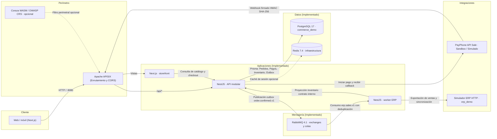
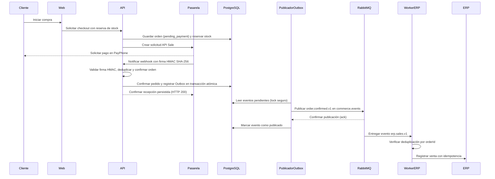

# GroupMG Commerce

**Base de comercio electrónico de GroupMG · TESSIUM Tech**

Monorepo TypeScript con storefront Next.js, API modular NestJS e integración ERP
asíncrona. Este repositorio define la estructura inicial de desarrollo, los límites
entre componentes y la infraestructura local.

> **Estado: Demo completa reproducible (M1-M4 completados).** El flujo de catálogo, carrito, órdenes con reserva de stock, pagos con PayPhone (modo sandbox y simulado), publicación transaccional outbox, mensajería RabbitMQ, consumo en Worker y conciliación/exportación con el Simulador ERP están implementados y verificados con pruebas deterministas, smoke tests y diagnóstico automatizado.

[Guion y checklist de presentación](docs/presentation-guide.md) · [Entorno de demo y diagnóstico](docs/demo-environment.md) · [Validación QA de integración](docs/qa/integration-validation.md) · [Arquitectura detallada](docs/architecture.md) · [Guía de desarrollo](docs/development.md) · [Roadmap](docs/roadmap.md) · [Reglas de la demo](docs/demo-rules.md)

## Arquitectura

Las líneas continuas representan componentes y flujos **implementados y funcionales**. Las líneas punteadas muestran extensiones pendientes u opcionales del backlog. El componente ERP corresponde a un **simulador HTTP aislado** (`@groupmg/erp-simulator`) con su propia base de datos persistente.



La API es dueña de las reglas de pedidos y pagos. Next.js se ocupa de la
experiencia web. El worker aísla los formatos y fallos del ERP mediante una capa
anticorrupción. Coraza se integrará como filtro WASM de APISIX; no está activo en
este init.

### Flujo objetivo de una compra

Este diagrama describe el comportamiento implementado de una compra completa:
el paso **pedido + outbox** se ejecuta como una sola transacción atómica en PostgreSQL.



La entrega es **al menos una vez**: un evento puede repetirse y el consumidor
lo deduplica con su tabla `ErpSaleExport`. Un fallo del ERP no deshace un pago confirmado. Reintentos,
cola de cartas muertas (DLQ) y reconciliación están descritos en la [arquitectura](docs/architecture.md) y en [la validación QA](docs/qa/integration-validation.md).

## Stack y estado actual

| Área         | Tecnología                | Estado en la Demo                                                                   |
| ------------ | ------------------------- | ----------------------------------------------------------------------------------- |
| Monorepo     | pnpm 12.5.1 / TypeScript  | Workspaces, lockfile congelado y configuración común                                |
| Web          | Next.js 16 / React 19     | Inicio, catálogo responsive, carrito interactivo, checkout y confirmación           |
| Backend      | NestJS 11                 | Catálogo, órdenes, pagos PayPhone, outbox transaccional y liveness/readiness real   |
| Worker       | NestJS 11                 | Consumo RabbitMQ, exportación a ERP, reconciliación de inventario con checkpoints   |
| Simulador    | NestJS 11                 | ERP simulado HTTP con persistencia propia en `erp_demo`, Swagger y simulación fallo |
| Contratos    | TypeScript                | Eventos versionados compartidos (`order.confirmed.v1`)                              |
| Gateway      | Apache APISIX             | Rutas web/API con readiness dependiente de servicios saludables                     |
| Persistencia | PostgreSQL 17             | Prisma, esquemas con CHECK constraints, migraciones y seed demo                     |
| Caché        | Redis 7.4                 | Contenedor en infraestructura para uso futuro de sesiones                           |
| Mensajería   | RabbitMQ 4.1              | Exchange `commerce.events`, cola `erp.sales.v1`, reintentos y DLQ                   |
| Diagnóstico  | Node.js nativo            | `pnpm demo:doctor`, enmascaramiento de secretos y reset demo explícito              |
| Calidad / CI | GitHub Actions / Prettier | Formato, tipos, build, migraciones, pruebas de DB, diagnósticos y E2E deterministas |

## Estructura del repositorio

```text
groupmg-commerce/
├── apps/
│   ├── web/                    # Páginas y experiencia de compra
│   ├── api/                    # Reglas de negocio y endpoints HTTP
│   └── worker-erp/             # Integración asíncrona y puerto ERP
├── packages/
│   └── contracts/              # Contratos compartidos y eventos versionados
├── infra/
│   ├── docker/                 # Dockerfile común por workspace
│   ├── apisix/                 # Configuración del gateway y rutas
│   └── coraza/                 # Plan de integración WAF
├── docs/
│   ├── architecture.md         # Decisiones, datos, flujos y límites
│   ├── development.md          # Guía operativa local
│   └── roadmap.md              # Etapas y criterios de aceptación
├── .github/workflows/ci.yml    # Validaciones automatizadas
├── .env.example               # Variables locales para Compose
├── compose.yaml               # Infraestructura y perfil de aplicaciones
├── pnpm-workspace.yaml        # Aplicaciones y paquetes del monorepo
└── pnpm-lock.yaml             # Resolución reproducible de dependencias
```

## Inicio rápido

### Requisitos

- **Node.js 24**, según `.nvmrc` y `engines`.
- **pnpm 12.5.1**, fijado en `packageManager`.
- **Docker con Compose v2** para levantar infraestructura o el entorno completo.
- Acceso al repositorio de la organización.

Con Node 24 y Corepack disponible, habilitar pnpm una sola vez:

```sh
corepack enable
corepack prepare pnpm@12.5.1 --activate
```

### Desarrollo local

```sh
git clone git@github.com:TESSIUM-Tech/groupmg-commerce.git
cd groupmg-commerce
pnpm install --frozen-lockfile
pnpm build
pnpm dev:web
```

Abrir [localhost:3000](http://localhost:3000). El frontend tiene recarga automática.
No requiere base de datos para mostrar las vistas iniciales.

Para ejecutar la API compilada en otra terminal:

```sh
pnpm --filter @groupmg/api start
```

La ruta [localhost:3001/api/v1/health](http://localhost:3001/api/v1/health)
verifica que el proceso está vivo.

### Backend con recarga

Después del primer `pnpm build`, usar dos terminales por servicio:

| Servicio   | Terminal de compilación | Terminal de ejecución                       |
| ---------- | ----------------------- | ------------------------------------------- |
| API        | `pnpm dev:api`          | `node --watch apps/api/dist/main.js`        |
| Worker ERP | `pnpm dev:worker`       | `node --watch apps/worker-erp/dist/main.js` |

Los scripts `dev:api` y `dev:worker` **solo recompilan**. El segundo comando
reinicia el proceso al cambiar los archivos compilados. El worker permanece
activo, pero aún no consume mensajes ni ejecuta tareas programadas.

### Infraestructura local

Copiar `.env.example` a `.env` una sola vez. En PowerShell:

```powershell
Copy-Item .env.example .env
```

En macOS/Linux:

```sh
cp .env.example .env
```

Con Docker en ejecución:

```sh
pnpm infra:up
```

Esto inicia PostgreSQL, Redis y RabbitMQ. Las credenciales del ejemplo son
exclusivamente locales. `.env` está excluido de Git.

### Todo con Docker

Con `.env` preparado:

```sh
docker compose --profile app up --build -d
```

Abrir [localhost:8080](http://localhost:8080). APISIX dirige el tráfico a web y API.
En esta modalidad no hay recarga del código: después de cambiar archivos,
reconstruir el servicio correspondiente, por ejemplo:

```sh
docker compose --profile app up --build -d web
```

El Dockerfile instala y compila con pnpm; el contenedor final ejecuta Node como
usuario no root y no necesita descargar pnpm al arrancar.

## Accesos locales

| Recurso             | Ejecución local                                                     | Ejecución con Docker                                                |
| ------------------- | ------------------------------------------------------------------- | ------------------------------------------------------------------- |
| Web                 | [localhost:3000](http://localhost:3000)                             | [localhost:8080](http://localhost:8080)                             |
| Liveness web        | [localhost:3000/health](http://localhost:3000/health)               | [localhost:8080/health](http://localhost:8080/health)               |
| Liveness API        | [localhost:3001/api/v1/health](http://localhost:3001/api/v1/health) | [localhost:8080/api/v1/health](http://localhost:8080/api/v1/health) |
| PostgreSQL          | Requiere infraestructura                                            | `127.0.0.1:5432`                                                    |
| Redis               | Requiere infraestructura                                            | `127.0.0.1:6379`                                                    |
| RabbitMQ AMQP       | Requiere infraestructura                                            | `127.0.0.1:5672`                                                    |
| RabbitMQ Management | Requiere infraestructura                                            | [localhost:15672](http://localhost:15672)                           |

Los endpoints de salud son **liveness**, no readiness: un `200` no certifica
conexión con bases de datos ni proveedores. El gateway usa HTTP local; TLS,
WAF y políticas de caché quedan pendientes.

Para inspeccionar y detener el entorno:

```sh
docker compose --profile app ps
docker compose logs -f api
docker compose --profile app down
```

`down` conserva los volúmenes. Compose representa un entorno de un solo host,
no un clúster de producción ni alta disponibilidad.

## Flujo de trabajo

1. Crear una rama para la funcionalidad.
2. Trabajar en la aplicación responsable del cambio.
3. Agregar dependencias al workspace que las necesita.
4. Validar antes del commit y abrir un pull request.

```sh
git switch -c feat/catalog
pnpm --filter @groupmg/api add nombre-del-paquete
pnpm format
pnpm typecheck
pnpm build
```

Versionar `pnpm-lock.yaml` junto con los cambios de dependencias. Para instalar
exactamente lo definido por el repositorio, usar `pnpm install --frozen-lockfile`.
Los contratos compartidos contienen formatos de intercambio, no entidades ORM
ni secretos. Las reglas y el estado de pedidos/pagos pertenecen a la API.

## Validación y CI

```sh
pnpm format:check
pnpm typecheck
pnpm build
docker compose --env-file .env.example --profile app config --quiet
```

La [CI](.github/workflows/ci.yml) ejecuta estas comprobaciones con el lockfile
congelado. Validar Compose comprueba su configuración; no prueba el tráfico
completo entre contenedores. Las pruebas de persistencia de DEMO-02 usan PostgreSQL real; pruebas comerciales y de ERP se añadirán en sus issues.

## Hitos de la Demo (M1 a M4 completados)

- [x] **M1:** Persistencia PostgreSQL, migraciones y seed reproducible ([docs/persistence.md](docs/persistence.md)).
- [x] **M1:** Catálogo conectado de extremo a extremo, frontend responsive y accesible ([docs/catalog-api.md](docs/catalog-api.md), [docs/frontend-validation.md](docs/frontend-validation.md)).
- [x] **M2:** Carrito, órdenes con checkout transaccional y reserva de inventario ([docs/orders.md](docs/orders.md)).
- [x] **M2:** Integración de pagos PayPhone (API Sale sandbox y modo simulado) con validación HMAC SHA-256 e idempotencia ([docs/payments.md](docs/payments.md)).
- [x] **M3:** Publicador Outbox transaccional y mensajería RabbitMQ con colas y DLQ ([docs/messaging.md](docs/messaging.md)).
- [x] **M3:** Worker ERP, adaptador anticorrupción y sincronización de inventario con conciliación y checkpoints ([docs/inventory-sync.md](docs/inventory-sync.md)).
- [x] **M4:** Entorno de demo reproducible con Docker Compose, readiness real, diagnóstico `demo:doctor` y reset seguro ([docs/demo-environment.md](docs/demo-environment.md)).
- [x] **M4:** Pruebas E2E deterministas en CI y smoke test de integración ([docs/qa/integration-validation.md](docs/qa/integration-validation.md)).
- [x] **M4:** Guion de demostración, escenarios de resiliencia y checklist previo ([docs/presentation-guide.md](docs/presentation-guide.md)).

### Backlog opcional post-demo

- [ ] **DEMO-17:** Cuentas de clientes e historial de pedidos autenticado ([docs/issues-demo.md](docs/issues-demo.md#demo-17--añadir-cuentas-de-clientes-e-historial-privado-opcional)).
- [ ] **DEMO-18:** Activación y validación de reglas de perímetro con Coraza WAF / OWASP CRS en APISIX ([docs/issues-demo.md](docs/issues-demo.md#demo-18--validar-coraza-y-reglas-de-perímetro-opcional)).

## Servicios y Documentación Interactiva

- **Storefront Web:** http://localhost:8080 (a través del Gateway APISIX).
- **Swagger API de Comercio:** http://localhost:8080/api/docs (documentación interactiva OpenAPI de endpoints).
- **Simulador ERP:** http://localhost:3003/docs (API de inventario, ventas y simulación de fallos; ver [docs/erp-simulator.md](docs/erp-simulator.md)).
- **RabbitMQ Management:** http://localhost:15672 (usuario: `commerce`, password: `local-only-demo`).
- **Diagnóstico del entorno:** `pnpm demo:doctor` (auditoría de puertos loopback, servicios y variables).
- **Guion paso a paso de presentación:** [docs/presentation-guide.md](docs/presentation-guide.md).
