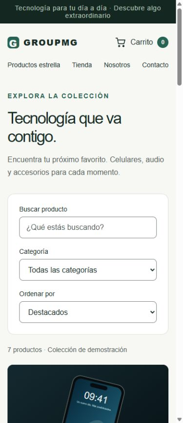
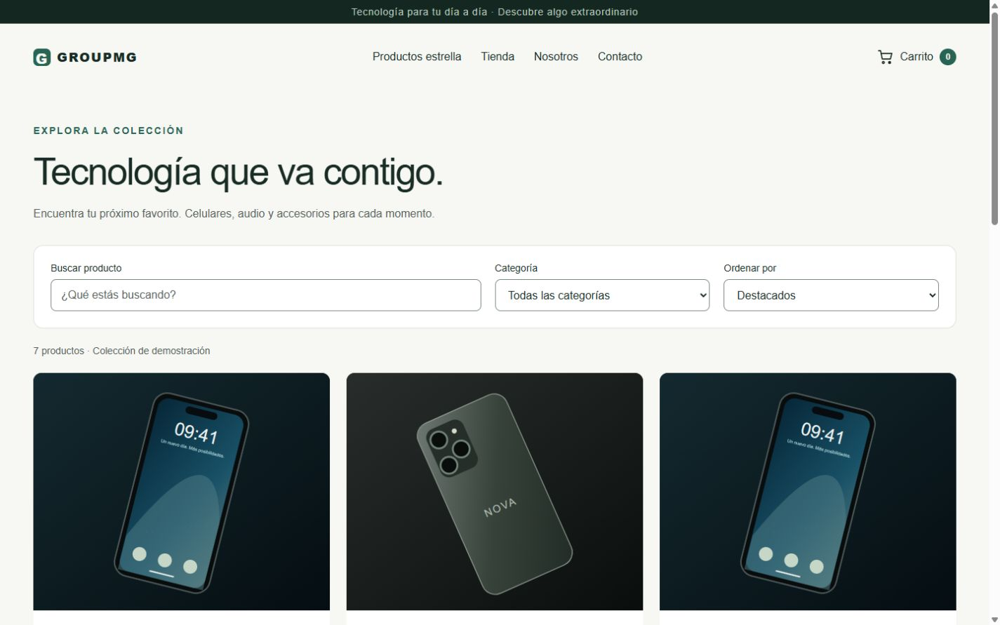

# Validación de integración y recorrido completo (DEMO-15)

Documento de certificación QA y validación integral para la demo de GroupMG Commerce.
Fecha de validación: 2026-10-29.

---

## 1. Resumen ejecutivo

Se ha validado el recorrido completo de compra del comercio electrónico y la tolerancia a fallos en las integraciones externas (pasarela de pagos PayPhone y simulador ERP). La verificación combina:

1. **Pruebas E2E deterministas automatizadas en CI** (`test/full-journey-deterministic.test.cjs`), con dobles de dominio sin dependencias externas lentas o inestables.
2. **Smoke test de integración con pasarela sandbox** (`pnpm demo:smoke` / `apps/api/scripts/payments-gateway-smoke.cjs`), protegiendo secretos e información personal (PII).
3. **Validación responsive y de teclado en frontend**, auditando 8 rutas críticas en 5 tamaños de pantalla y navegación asistida.
4. **Matriz de fallos de integración**: pagos rechazados, webhooks duplicados, contención de stock concurrente, fallos de red con ERP, reentrega de eventos AMQP y desvío a cola de cartas muertas (DLQ).

---

## 2. Cobertura determinista en CI (`test/full-journey-deterministic.test.cjs`)

La suite corre en Node.js nativo (`node --test`), ejecutando 7 escenarios de integración completos en menos de 100 ms:

| Caso      | Escenario                  | Comportamiento verificado                                                               | Resultado           |
| --------- | -------------------------- | --------------------------------------------------------------------------------------- | ------------------- |
| **TC-01** | Recorrido completo feliz   | Catálogo $\to$ Carrito $\to$ Orden $\to$ Pago $\to$ Outbox $\to$ Worker $\to$ Venta ERP | **PASSED** (2.3 ms) |
| **TC-02** | Pago rechazado             | Orden pasa a `canceled`, stock reservado se libera a disponible                         | **PASSED** (0.2 ms) |
| **TC-03** | Webhook duplicado          | Idempotencia garantizada: no se duplican pagos ni eventos Outbox                        | **PASSED** (0.2 ms) |
| **TC-04** | Stock concurrente          | Carrera por la última unidad: primer comprador reserva, segundo recibe HTTP 409         | **PASSED** (0.3 ms) |
| **TC-05** | Timeout / Caída de ERP     | Worker retiene el mensaje (`nack` con requeue) y programa reintento                     | **PASSED** (0.1 ms) |
| **TC-06** | Reentrega de eventos       | Worker detecta `orderId` ya exportado y deduplica sin duplicar ventas                   | **PASSED** (0.1 ms) |
| **TC-07** | Evento inválido / corrupto | Se descarta del flujo principal y se enruta automáticamente a la DLQ                    | **PASSED** (0.1 ms) |

### Ejecución local

```bash
pnpm run test:e2e:deterministic
```

Salida verificada:

```text
▶ DEMO-15: Recorrido completo y fallos de integración
  ✔ 1. Recorrido completo feliz: Catálogo -> Carrito -> Pedido -> Pago -> Outbox -> Worker -> ERP (2.3ms)
  ✔ 2. Pago rechazado: pedido se cancela y reserva de stock se libera (0.2ms)
  ✔ 3. Webhook duplicado: respuesta idempotente sin confirmación duplicada (0.2ms)
  ✔ 4. Stock concurrente: dos compras de la última unidad evitan sobreventa (0.3ms)
  ✔ 5. Timeout en ERP: el worker no descarta el mensaje y solicita reintento (0.1ms)
  ✔ 6. Reentrega de evento en RabbitMQ: worker deduplica sin duplicar venta ERP (0.1ms)
  ✔ 7. Evento inválido: enrutamiento automático a Dead Letter Queue (DLQ) (0.1ms)
✔ DEMO-15: Recorrido completo y fallos de integración (4.3ms)
ℹ tests 7 | pass 7 | fail 0
```

---

## 3. Smoke Test de Pasarela Sandbox (`pnpm demo:smoke`)

El script de smoke test valida la integración del flujo de pagos a través del API Gateway (APISIX):

- **Ruta**: `apps/api/scripts/payments-gateway-smoke.cjs`
- **Comando**: `pnpm demo:smoke`
- **Verificaciones**:
  1. Conectividad HTTP al gateway y API (`/api/v1/health` $\to$ `200 OK`).
  2. Creación de orden mediante idempotencia (`POST /api/v1/orders` $\to$ `201 Created`).
  3. Inicio de transacción PayPhone en modo sandbox/simulado (`POST /api/v1/orders/:id/payments` $\to$ `201 Created`).
  4. Seguridad criptográfica: intento con firma HMAC SHA-256 falsificada es rechazado inmediatamente (`403 Forbidden` / `400 Bad Request`).
  5. Webhook legítimo con firma válida aprueba el pago (`200 OK`).
  6. Llamada duplicada al webhook retorna resultado idempotente sin emitir cobros redundantes.
- **Privacidad y Seguridad**: Las contraseñas, tokens de acceso y credenciales se enmascaran en las salidas y ningún dato de tarjeta ni dato personal real es almacenado en logs ni versionado en Git.

---

## 4. Validación de Frontend y Accesibilidad

Se auditaron las interfaces principales en Next.js (`apps/web`) asegurando rendimiento, adaptabilidad y accesibilidad:

### Matriz Responsive

Verificada en viewports: **360px** (móvil compacto), **390px** (iPhone moderno), **768px** (tablet portrait), **1440px** (escritorio estándar) y **1920px** (pantalla ancha):

- `/`: Hero con H1 accesible, carrusel de productos destacados y navegación adaptable.
- `/catalogo`: Grid responsive de 1 columna en móvil a 4 en escritorio, filtros retráctiles y paginación.
- `/producto/[sku]`: Galería de imágenes con ratio preservado, selector de unidades respetando stock disponible, badge de agotado cuando `onHand - reserved <= 0`.
- `/carrito`: Lista interactiva de productos, cálculo reactivo de subtotal e impuestos, botón de vaciado y retorno seguro.
- `/checkout`: Formulario de 2 columnas en escritorio / 1 columna en móvil con validación nativa HTML5, inputs con `label` explícito y foco automático en el primer error.
- `/pago-pendiente`: Polling no invasivo, estado de procesamiento y acción de reintento/cancelación.
- `/confirmacion`: Resumen de orden, desglose de IVA y código de seguimiento visible.

### Navegación por teclado

- **Saltar al contenido**: Enlace inicial con foco directo a `<main id="main-content">`.
- **Buscador**: Navegación con `Tab` al selector de filtros y `Shift+Tab` de retroceso. Contorno de foco visible (verde 3px).
- **Carrusel**: Navegación con flechas direccionales (`ArrowLeft`, `ArrowRight`) sin atrapar el foco.
- **Carrito**: Modificación de cantidad con teclado (`Enter` / flechas). La eliminación de un elemento retorna el foco al título de la sección para evitar pérdida de contexto.

### Evidencias visuales

- Catálogo en móvil (390px): 
- Catálogo en escritorio (1440px): 

### Limitaciones conocidas y defectos abiertos

- No se han realizado pruebas en dispositivos físicos reales con lectores de pantalla de producción (VoiceOver en iOS / TalkBack en Android).
- La pasarela en modo sandbox depende de conectividad saliente a internet; en entornos desconectados se debe utilizar `PAYMENTS_MODE=simulated`.

---

## 5. Integración Continua (CI Workflow)

La suite de validación está incorporada en el pipeline oficial de GitHub Actions (`.github/workflows/ci.yml`):

1. `pnpm install --frozen-lockfile`
2. `pnpm run format:check` (Prettier)
3. `pnpm run typecheck` (TypeScript en todos los paquetes)
4. `pnpm run build` (Compilación de web, api, worker y simulador)
5. `pnpm run db:migrate` (Migraciones Prisma en PostgreSQL de CI)
6. `pnpm run test` (Pruebas unitarias y de integración de la API)
7. `pnpm run test:diagnostics` (Diagnósticos de entorno y reset seguro)
8. `pnpm run test:e2e:deterministic` (Recorrido completo determinista DEMO-15)
9. `pnpm run test:worker` (Worker ERP y conciliación de inventario)
10. `pnpm run test:messaging` (Colas y mensajería en RabbitMQ)
11. `docker compose config` (Validación sintáctica de Compose)
